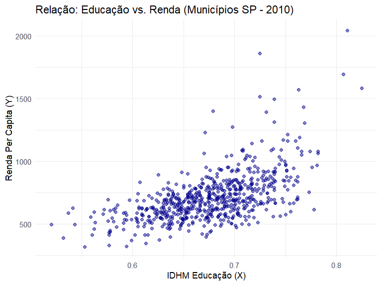
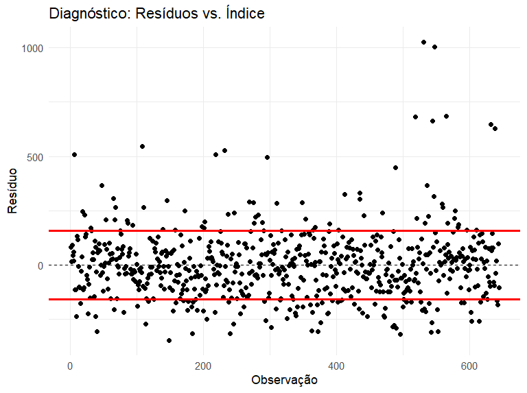
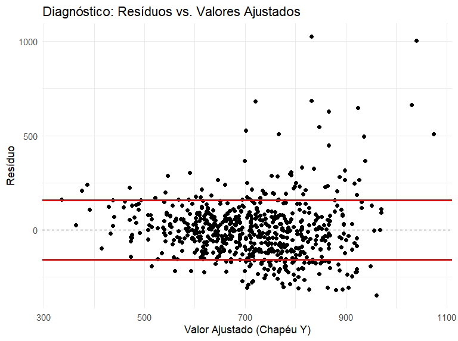
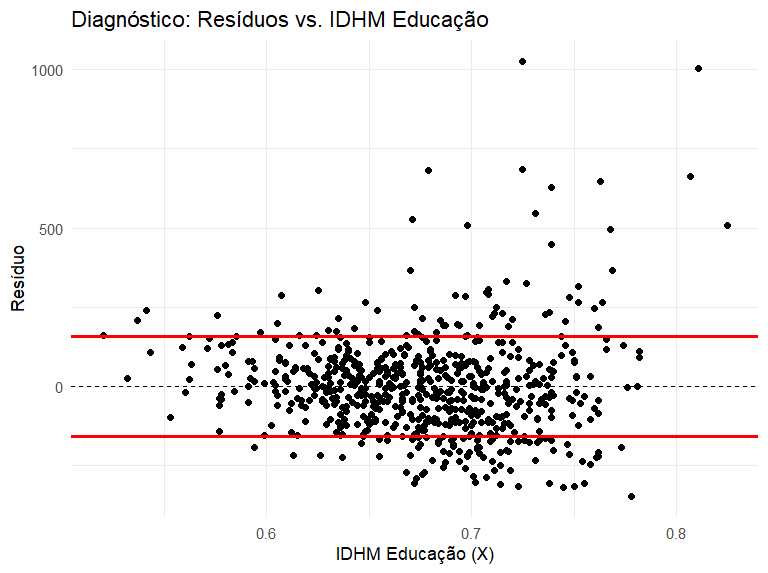
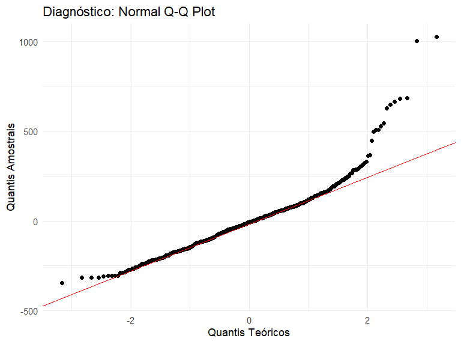
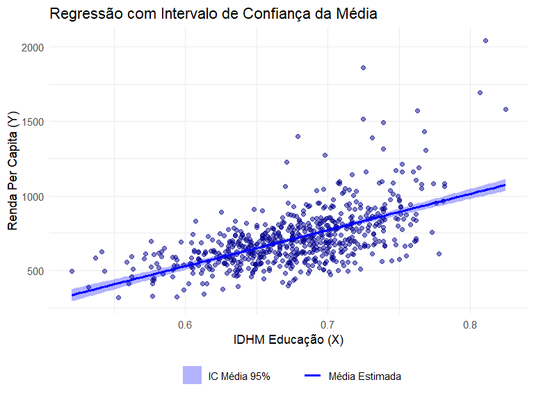
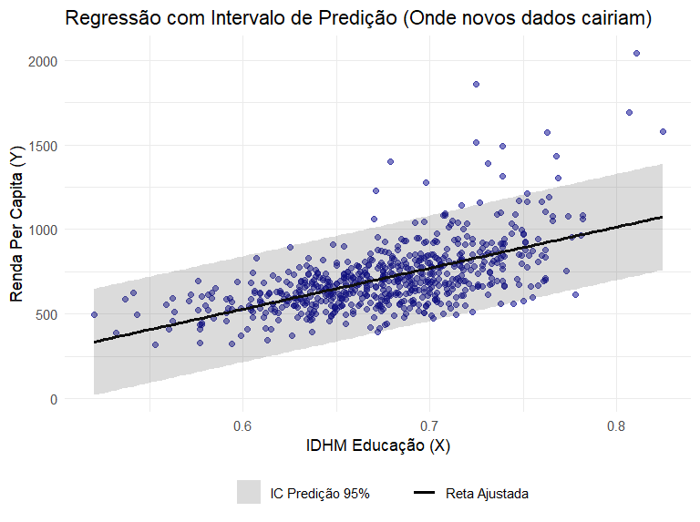

# 📈 Educação e Renda nos Municípios Paulistas: uma Análise de Regressão Linear Simples


Projeto final da disciplina SME0220, do ICMC-USP.

O projeto investiga se o nível educacional de um município ajuda a explicar a sua renda,
usando um modelo de regressão linear simples ajustado por mínimos quadrados sobre os
645 municípios do estado de São Paulo (Censo 2010).

---

## 📑 Sumário

- [Pergunta de pesquisa](#-pergunta-de-pesquisa)
- [Dados](#-dados)
- [Metodologia](#-metodologia)
- [Principais resultados](#-principais-resultados)
- [Diagnóstico do modelo](#-diagnóstico-do-modelo)
- [Aplicação prática e predição](#-aplicação-prática-e-predição)
- [Conclusões](#-conclusões)
- [Estrutura do repositório](#-estrutura-do-repositório)
- [Como reproduzir](#-como-reproduzir)
- [Créditos e fonte dos dados](#-créditos-e-fonte-dos-dados)

---

## 🎯 Pergunta de pesquisa

> É possível modelar e prever a renda de um município com base, de forma linear, no seu índice educacional?

A hipótese vem da teoria do capital humano. Mais educação tende a aumentar a produtividade do
trabalho e, com isso, a renda.

| Papel | Variável | Descrição |
|---|---|---|
| **X** (explicativa) | IDHM Educação | Índice de 0 a 1 que sintetiza a escolaridade da população adulta e o fluxo escolar da população jovem |
| **Y** (resposta) | Renda per capita | Renda mensal média por habitante do município, em R$ |

## 🗂️ Dados

- **Fonte** [Atlas do Desenvolvimento Humano no Brasil](http://atlasbrasil.org.br/) (PNUD Brasil, Ipea e FJP), com dados do Censo 2010.
- **Arquivo** [`analise/dados_atlas.csv`](analise/dados_atlas.csv)
- **Amostra final** 645 municípios de SP, com IDHM Educação entre 0,520 e 0,825 e renda per capita entre R$ 318,44 e R$ 2.043,74.

O CSV está no formato brasileiro (separador `;` e decimal com vírgula) e traz linhas de
agregação (Brasil e estado de São Paulo) e colunas vazias geradas pela exportação.
O script trata tudo isso.

1. Lê o arquivo com `read.csv2`.
2. Mantém só as 3 primeiras colunas.
3. Filtra os municípios com `(SP)` no nome, removendo os totais.
4. Converte vírgula em ponto e garante o formato numérico.
5. Descarta linhas com valores faltantes.

## 🧪 Metodologia

Modelo ajustado

$$Y_i = \beta_0 + \beta_1 X_i + \varepsilon_i, \qquad \varepsilon_i \sim \text{Normal}(0, \sigma^2)$$

Os coeficientes são os que minimizam a soma dos quadrados dos erros de predição
(**Critério de Mínimos Quadrados**).

$$Q(\beta_0, \beta_1) = \sum_{i=1}^{n} (Y_i - \beta_0 - \beta_1 X_i)^2$$

O fluxo da análise está todo em [`analise/analise.R`](analise/analise.R).

1. **Análise exploratória** com diagrama de dispersão.
2. **Ajuste** com `lm(y ~ x)`.
3. **Inferência** com estimativas, erros-padrão e intervalos de confiança de 95% para os coeficientes.
4. **Diagnóstico** com quatro gráficos de resíduos (contra índice, valores ajustados e preditora, mais Q-Q plot).
5. **Predição** com bandas de confiança (para a média) e de predição (para um município individual).

## 📊 Principais resultados



Há uma tendência positiva clara. Municípios com IDHM Educação maior tendem a ter renda per capita maior.

**Reta ajustada**

$$\hat{Y} = -925{,}25 + 2423{,}61 \cdot X$$

| Quantidade | Valor |
|---|---|
| Intercepto (β̂₀) | -925,25 |
| Inclinação (β̂₁) | 2.423,61 |
| IC 95% para β₁ | [2.169,51 ; 2.677,70] |
| Significância de β₁ | p < 2 × 10⁻¹⁶ |
| R² | 0,353 |

**Interpretação**

- **Inclinação.** Cada aumento de 0,1 no IDHM Educação está associado, em média, a um aumento de cerca de **R$ 242,36** na renda per capita mensal. O intervalo de confiança não contém o zero, então a associação é estatisticamente significativa.
- **Intercepto.** Corresponderia a um município com IDHM Educação igual a zero, que não existe na amostra. Interpretá-lo seria extrapolar, então ele serve apenas para posicionar a reta na faixa observada.
- **R² = 0,353.** A educação sozinha explica cerca de 35,3% da variabilidade da renda. Os outros 65% vêm de fatores fora do modelo, como estrutura produtiva e logística.

## 🔍 Diagnóstico do modelo

Os resíduos foram avaliados graficamente para checar as suposições do modelo.

| Resíduos vs. índice | Resíduos vs. valores ajustados |
|---|---|
|  |  |

| Resíduos vs. IDHM Educação | Q-Q plot normal |
|---|---|
|  |  |

O que os gráficos mostram

- **Assimetria à direita e outliers.** Os resíduos vão de -346,15 a +1.026,82. O modelo subestima bastante a renda de alguns municípios muito ricos, cuja riqueza vem de fontes além da educação.
- **Heterocedasticidade.** Há um padrão de funil, com a variância dos erros crescendo junto com a renda. As predições são mais precisas para municípios de renda baixa do que para os de renda alta.
- **Normalidade.** O Q-Q plot segue a reta no centro, mas se afasta nas caudas, em especial na superior. É um comportamento comum em dados socioeconômicos.

> ⚠️ A relação linear é real e significativa, mas as suposições de variância constante
> e normalidade não são atendidas perfeitamente. As inferências devem ser lidas com essa ressalva.

## 🔮 Aplicação prática e predição

Cenário hipotético de um município com **IDHM Educação igual a 0,75**.

| Item | Resultado |
|---|---|
| Renda esperada (estimativa pontual) | **R$ 892,46** |
| IC 95% para a **média** de renda de municípios com IDHM 0,75 | [R$ 870,07 ; R$ 914,85] |
| Intervalo de predição 95% para **um município específico** | [R$ 579,62 ; R$ 1.205,29] |

O intervalo de predição é bem mais largo porque, além da incerteza sobre onde passa a reta,
ele inclui a variabilidade individual de cada município (o erro aleatório ε).

| Banda de confiança (média) | Banda de predição (indivíduo) |
|---|---|
|  |  |

## ✅ Conclusões

1. **Existe relação linear positiva e estatisticamente significativa** entre educação e renda nos municípios paulistas.
2. **O efeito é quantificável**, com cerca de R$ 242 a mais de renda per capita mensal a cada 0,1 ponto de IDHM Educação.
3. **Há limitações.** O modelo explica 35,3% da variação, e os resíduos indicam heterocedasticidade e outliers positivos. A educação parece condição necessária, mas não suficiente, para explicar os extremos de riqueza do estado.

## 📁 Estrutura do repositório

```
.
├── analise/
│   ├── analise.R              # script completo (limpeza, ajuste, diagnóstico, predição)
│   └── dados_atlas.csv        # dados do Atlas Brasil (Censo 2010)
├── relatorios/
│   ├── Relatorio_AnaliseDeRegressaoLinear.pdf     # relatório final da análise
├── docs/
│   └── img/                   # figuras usadas neste README
├── .gitignore
└── README.md
```

## ▶️ Como reproduzir

**Requisitos.** [R](https://cran.r-project.org/) e, de preferência, o [RStudio](https://posit.co/download/rstudio-desktop/).
Os pacotes `tidyverse`, `scales` e `broom` são instalados automaticamente pelo script se estiverem faltando.

```bash
# 1. Clonar o repositório
git clone https://github.com/leonardo-eid/Regressao-Linear-Educacao-Renda_SME0220.git
cd Regressao-Linear-Educacao-Renda_SME0220/analise

# 2. Rodar o script (precisa ser executado de dentro da pasta analise/)
Rscript analise.R
```

Ou, no RStudio, abra `analise/analise.R`, defina a pasta `analise/` como diretório de trabalho
(*Session → Set Working Directory → To Source File Location*) e execute o script.

> 💡 Rodando via `Rscript`, os gráficos são salvos em um único `Rplots.pdf` (ignorado pelo `.gitignore`).
> No RStudio eles aparecem direto no painel *Plots*.

O console mostra o resumo do modelo, os intervalos de confiança dos coeficientes e os resultados
da predição para IDHM igual a 0,75.

## 📚 Créditos e fonte dos dados

- Projeto da disciplina SME0220 (Introdução à Teoria das Probabilidades), ICMC-USP, 2025.
- Dados do *Atlas do Desenvolvimento Humano no Brasil*, PNUD Brasil, Ipea e FJP, 2022, com base em IBGE e registros administrativos.
